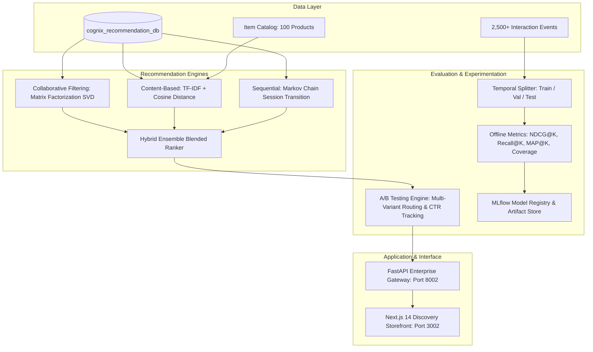

# Recommendation System: Architecture Blueprint

## 1. Engine Separation & Decoupling
- **Collaborative Filtering**: Computes a sparse User-Item interaction matrix $R \in \mathbb{R}^{|U| \times |I|}$. Decomposes $R \approx P \cdot Q^T$ using truncated singular value decomposition into $k$ latent factors.
- **Content-Based Engine**: Constructs item feature vectors $v_i$ using TF-IDF over categories, tags, and product specifications. Builds user preference vectors $u_u = \sum_{i \in I_u} w_{u,i} v_i$.
- **Sequential Session Engine**: Models first-order Markov transition probabilities $P(i_t \mid i_{t-1}) = \frac{C(i_{t-1}, i_t)}{\sum_j C(i_{t-1}, j)}$ across session clickstreams.
- **Hybrid Ensemble**: Blends scores:
  $$S_{hybrid}(u, i) = \alpha S_{cf}(u, i) + \beta S_{cb}(u, i) + \gamma S_{seq}(s, i)$$
  with automatic fallback for zero-history users.
