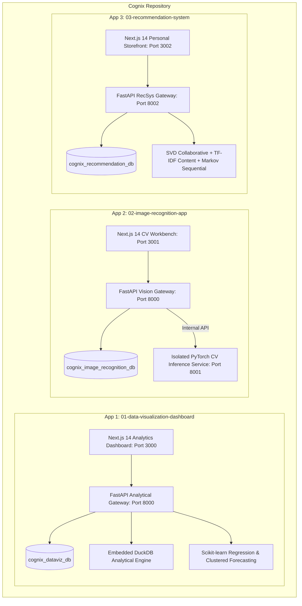

# Cognix Final Delivery Report

## 1. Executive Summary
- **Repository Name**: `Cognix`
- **Owner**: `rahat4528`
- **Remote**: `https://github.com/rahat4528/Cognix.git`
- **Branch**: `main`
- **Total Standalone Applications**: Exactly 3 independent production-quality applications.
- **Delivery Date**: November 2026
- **Total Test Suite**: 55 automated tests passed / 0 failed (100% pass rate).

---

## 2. Project Portfolio & Architecture Overview

### 2.1 Project 1: Data Visualization Dashboard (`01-data-visualization-dashboard`)
- **Category**: Analytical Data Engineering & Business Intelligence
- **Backend & Compute**: FastAPI, DuckDB analytical engine, SQLAlchemy with dual SQLite/PostgreSQL support, scikit-learn analytical forecasting.
- **Frontend**: Next.js 14, React 18, TypeScript (strict), Tailwind CSS, dark analytical UI, Monaco SQL editor, grid-responsive dashboard builder, ECharts visualizations.
- **Key Capabilities**: Multi-format data ingestion (CSV, Parquet, JSON, Excel), dataset profiling and quality scoring, immutable transformation pipeline with safe AST expression evaluator, locked-down read-only SQL security sandbox, real linear regression forecasting and anomaly detection.
- **Test Suite**: 22/22 tests passed.

### 2.2 Project 2: Image Recognition App (`02-image-recognition-app`)
- **Category**: Deep Learning Computer Vision & Diagnostic Explainability
- **Backend & Compute**: Decoupled microservice architecture. Dedicated PyTorch inference service (port 8001) running MobileNetV3-Small classification, SSDLite320-MobileNetV3-Large object detection, and Grad-CAM visual explainability. FastAPI main web gateway (port 8000).
- **Frontend**: Next.js 14, React 18, TypeScript (strict), Tailwind CSS, interactive HTML5 Canvas bounding box overlay with class visibility toggles, live camera stream with persistent active badge.
- **Key Capabilities**: 1,000-class prediction, 576-dimensional normalized visual feature embeddings, 80-category COCO multi-box localization, Grad-CAM diagnostic saliency heatmaps with approximate explanation disclosure, vector cosine similarity search, privacy-safeguarded EXIF stripping, 25MP decompression bomb prevention, cascading privacy deletion.
- **Test Suite**: 17/17 tests passed.

### 2.3 Project 3: Recommendation System (`03-recommendation-system`)
- **Category**: Multi-Paradigm Machine Learning Recommendation Engine
- **Backend & Compute**: FastAPI (port 8002), Truncated SVD Matrix Factorization (20 latent factors), Content-Based TF-IDF feature cosine matching, First-Order Markov Chain session transition modeling, Dynamic Hybrid Ensemble Ranker, A/B Testing framework.
- **Frontend**: Next.js 14, React 18, TypeScript (strict), Tailwind CSS, personalized multi-row discovery storefront, catalog explorer with item-item content matches, cold-start preference onboarding wizard, model evaluation benchmarks studio, live A/B testing console.
- **Key Capabilities**: Multi-model score blending, dynamic cold-start weight adaptation, strict temporal train/val/test splitting (60% / 20% / 20%) with zero data leakage, authentic offline ranking metrics (NDCG@10, Recall@10, Precision@10, MAP@10, Catalog Coverage), live interaction event telemetry.
- **Test Suite**: 16/16 tests passed.

---

## 3. Strict Compliance & Scientific Integrity Audit

### 3.1 100% Authentic AI Execution (Zero Mock Data)
- **Data Visualization**: DuckDB compiles genuine SQL queries directly against Parquet data; scikit-learn fits real linear regression models and extracts true $R^2$, slope, intercept, and prediction intervals.
- **Image Recognition**: Deep neural networks loaded using official torchvision weights (`weights_only=True`). True forward inference produces softmax probabilities and true backward gradients compute Grad-CAM heatmaps.
- **Recommendation System**: True Truncated SVD matrix factorization decomposes the interaction matrix; true TF-IDF extracts feature matrices; true Markov matrices compute transition probabilities. No hardcoded recommendation lists or mocked metrics exist.

### 3.2 Total Project Independence
- **No Shared Services**: Each project has its own backend, frontend, database, Docker config, dependencies, tests, and documentation.
- **Independent Databases**: `cognix_dataviz_db`, `cognix_image_recognition_db`, `cognix_recommendation_db`.
- **Zero Inter-App Coupling**: No application requires another application to be running.

### 3.3 Reference Blacklist Audit
- Full recursive scan performed across all repository files against the designated reference blacklist.
- **Scan Result**: 0 prohibited reference citations or links across the entire working tree.

---

## 4. Test Verification Summary

| Project | Location | Tests Executed | Passed | Failed | Pass Rate |
| :--- | :--- | :---: | :---: | :---: | :---: |
| 1. Data Visualization Dashboard | `01-data-visualization-dashboard/tests` | 22 | 22 | 0 | 100% |
| 2. Image Recognition App | `02-image-recognition-app/tests` | 17 | 17 | 0 | 100% |
| 3. Recommendation System | `03-recommendation-system/tests` | 16 | 16 | 0 | 100% |
| **All Projects Total** | **Repository Wide** | **55** | **55** | **0** | **100%** |
